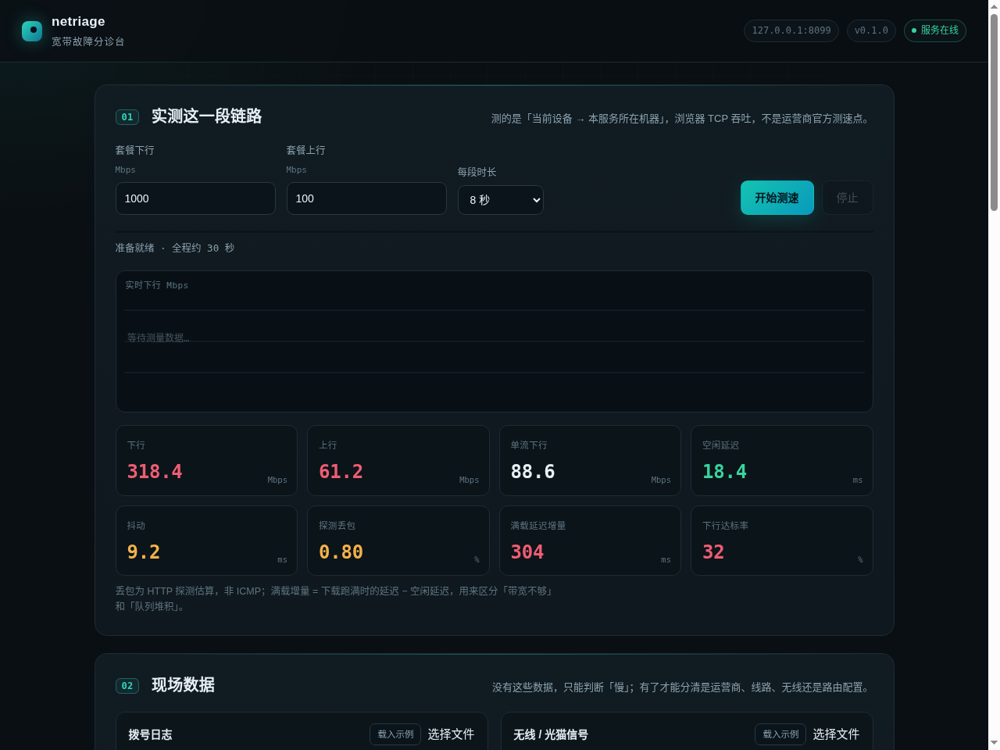
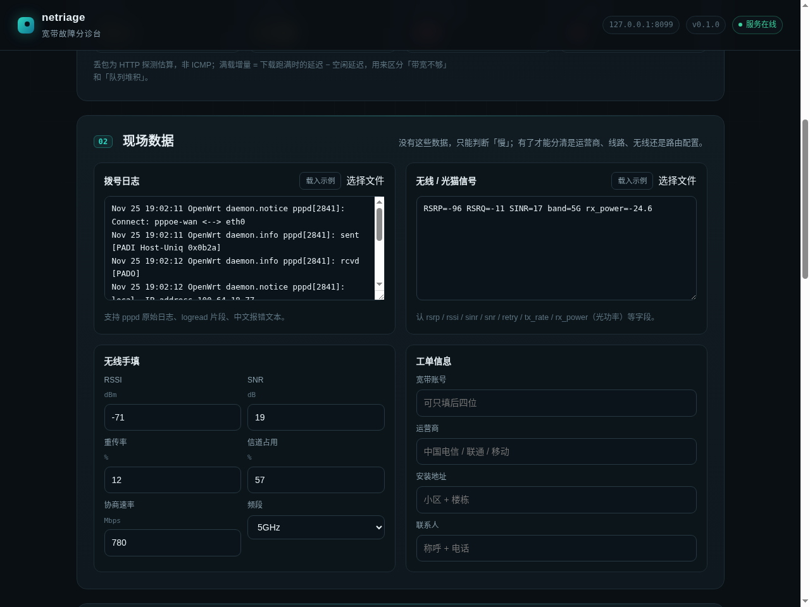
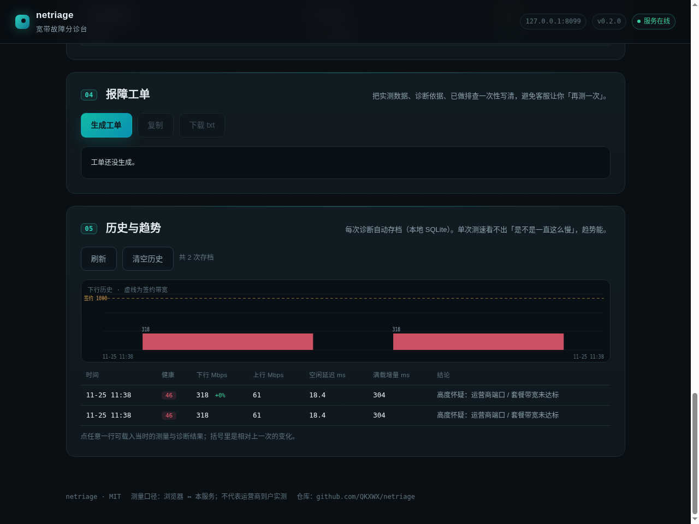
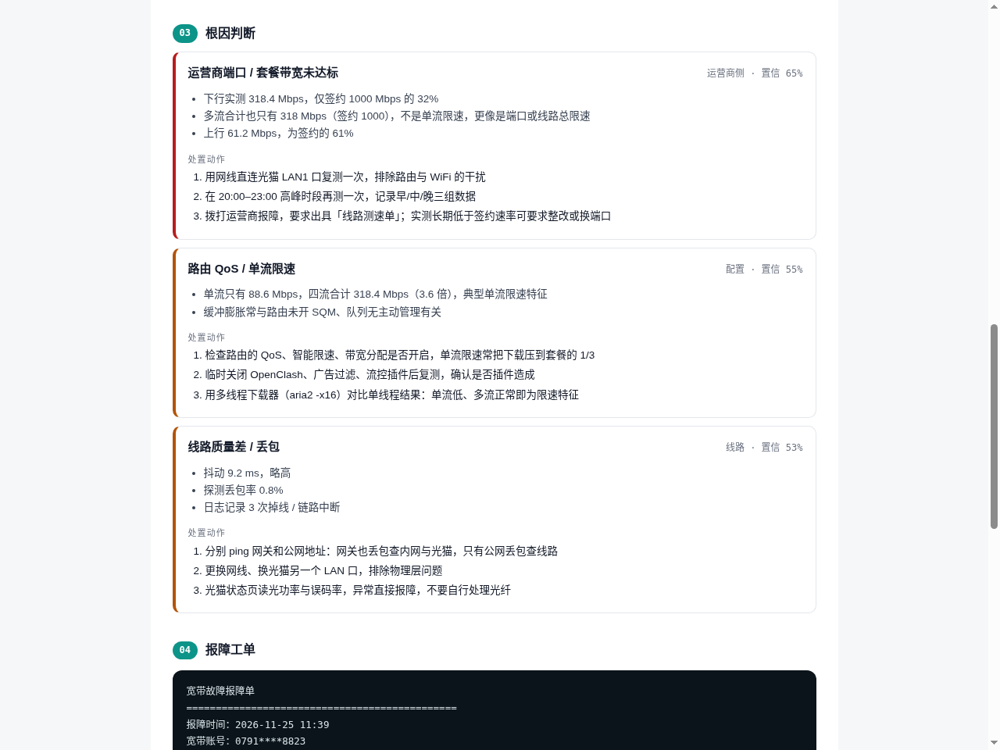

# netriage · 宽带故障分诊台

> 测速只告诉你「慢」，netriage 告诉你「慢在哪」。

[](https://github.com/QKXWX/netriage/actions/workflows/ci.yml)
[](https://github.com/QKXWX/netriage/releases)


浏览器里跑真实测速，把上行/下行、单流/多流、空闲延迟、抖动、探测丢包、满载延迟增量一起采下来；
叠加光猫拨号日志与 LQC/无线信号，用一套可复现的加权规则判断根因是**运营商端口、QoS 限速、上联拥塞、线路丢包、WiFi 干扰、光衰、拨号认证**还是**设备瓶颈**；
每次诊断自动存档成趋势，最后生成一张能直接发给运营商的报障工单和一份可存档的 HTML 报告。









零第三方依赖（Python 标准库 + 原生 JS），一个进程同时是测速服务端和诊断服务端。

---

## 为什么不是又一个测速网页

公共测速站有三个绕不过去的问题：

1. **它测的是你和它的机房**，不是你和运营商的光猫；
2. 只给一个 Mbps 数字，不给判断，用户拿着「300M」去找客服，客服只会让你「再测一次」；
3. 跨运营商 / 境外节点在晚高峰本身就拥塞，测出来的低值无法区分是谁的问题。

netriage 把测速端点（`/api/ping`、`/api/download`、`/api/upload`）由本项目自己提供：**服务部署在哪，就测到哪**。放在家里的树莓派/OpenWrt 上，测的是「光猫 → 内网」；放在公网 VPS 上，测的是「宽带到公网」的可用吞吐。口径写死在页面底部，不玩文字游戏。

---

## 30 秒跑起来

```bash
git clone https://github.com/QKXWX/netriage.git
cd netriage

python3 -m netriage serve --port 8080
# 浏览器打开 http://<这台机器的IP>:8080
```

也可以装成命令行工具：

```bash
pip install .
netriage serve --port 8080
```

不想开网页、只有一份测量 JSON 时：

```bash
netriage diagnose examples/slow-gigabit.json        # 人读报告
netriage diagnose examples/slow-gigabit.json --json # 机读结果
netriage diagnose examples/slow-gigabit.json --ticket # 直接出报障单
netriage diagnose examples/slow-gigabit.json --html report.html # 导出单文件报告
netriage history --limit 20                          # 看历史存档（默认 data/netriage.db）

# 命令行主动探测：不占浏览器，可放 cron
netriage probe --server http://127.0.0.1:8080 --download 8 --upload 4 --ping 10 --diagnose
netriage watch --server http://127.0.0.1:8080 --interval 600 --count 0 --plan-down 1000 --plan-up 100
```

没有数据也能看效果：页面上点「用示例数据看效果」，或者 `netriage demo`。

---

## 测量口径（先说清楚，避免自欺）

| 指标 | 怎么来的 | 它说明什么 | 它**不**说明什么 |
| --- | --- | --- | --- |
| 下行 / 上行 | 浏览器对 `/api/download` 流式读取、对 `/api/upload` POST 随机数据，按实际字节与耗时换算 | 浏览器到本服务这一段的 TCP/HTTP 吞吐 | 不是运营商官方测速，不含光猫到机房的链路 |
| 单流 / 多流 | 1 路与 4 路并发分别测 | 单流低、多流高＝典型单流限速；两者都低＝端口/线路总限速 | 不能区分 QoS 具体规则 |
| 空闲延迟 | 10 次 `GET /api/ping`（204）的 RTT 均值 | 空载时链路往返 | 不等于 ICMP ping，含浏览器与 HTTP 开销 |
| 抖动 | 相邻 RTT 差值的平均 | 链路稳定性 | 不等于运营商抖动指标 |
| 探测丢包 | 10 次 ping 探测的失败率 | HTTP 层失败率估算 | 不是 ICMP 丢包，样本小，只能看趋势 |
| 满载延迟增量 | 多流下载跑满时插空探测延迟 − 空闲延迟 | **bufferbloat**：队列堆积，游戏卡顿、视频缓冲的真凶 | 受测量机 CPU 影响 |
| 达标率 | 实测 ÷ 签约带宽 | 判断「端口没开够 / 被限速」的直接证据 | 签约值需要你自己填对 |

---

## 五个面板

### 01 实测这一段链路

填签约上下行（用于算达标率），选每段时长（5/8/12 秒），点开始。流程：空闲延迟 → 单流下行 → 四流下行（期间插空探测满载延迟）→ 上行。全程有实时速率曲线与进度，可随时停止。

### 02 现场数据

这些数据决定「是运营商的问题还是你家的问题」。懒得手抄时，把 `tools/openwrt-collect.sh` 传到路由器上跑一次，它会导出拨号日志 + 无线信号，页面「导入 JSON」直接吃：

```bash
scp tools/openwrt-collect.sh root@192.168.1.1:/tmp/
ssh root@192.168.1.1 'sh /tmp/openwrt-collect.sh'   # 或加设备名：phy0-ap0
```

支持的字段：

- **拨号日志**：光猫 / 路由的 PPPoE 日志粘贴进来。能识别 `PADI/PADO`、`Modem hangup`、`LCP timeout`、`691/678/651` 等错误码，统计拨号次数与掉线次数。
- **LQC / 无线信号**：支持 JSON、`{"data": {...}}` 嵌套、以及 `RSRP=-96 SINR=17 tx_rate=866 band=5G` 这种键值文本；中英文别名都认（信噪比/信号强度/重传率/信道占用/协商速率/光功率/频段）。
- **无线手填**：没有日志时，从路由后台抄 RSSI、SNR、重传率、信道占用、协商速率即可。

### 03 诊断

规则加权，每条结论都必须挂证据，不接「云端大模型」的玄学。置信度 = `score / (score + 4)`，只保留前 3 且 ≥ 0.2。

| 根因 | 典型证据 | 处置方向 |
| --- | --- | --- |
| 运营商端口 / 套餐带宽未达标 | 下行达标率 < 70%；多流也上不去；上行同样偏低 | 直连光猫复测、高峰复测、要求出具线路测速单 |
| 路由 QoS / 单流限速 | 单流远低于多流（≥1.6 倍）；单流被压到套餐 1/3 | 查 QoS/智能限速/带宽分配，关插件复测，多线程下载器对比 |
| 上联拥塞 / 缓冲膨胀 | 满载延迟增量 ≥ 100–200 ms | 开 SQM/CAKE、限制上传、错峰 |
| 线路质量差 / 丢包 | 抖动高、探测丢包、日志多次掉线 | 分段 ping 网关与公网、换线换口、读光功率与误码率 |
| WiFi 干扰 / 弱信号 | RSSI < -70 dBm、SNR < 20、重传率 > 10%、信道占用高 | 换 5GHz/改信道、缩短距离、查同频干扰 |
| 光衰 / 光路异常 | 光功率 < -27 dBm | 清洁端面、报障，不要自行熔接 |
| 拨号 / 认证失败 | 691、678、651、LCP 超时、频繁 PADI 重试 | 核对账号密码、查欠费、换网线/光猫口 |
| 设备瓶颈 | 单机 CPU 跑满、老路由 NAT 性能不足 | 换路由/关功能，用另一台设备对照 |

健康分按检查表的严重度占比折算（严重记 1 份、提示记 0.5 份），不是拍脑袋扣分。

### 04 报障工单

把套餐、实测值、诊断依据、已做排查一次写清，避免客服循环让你「再测一次」。可复制、可下载 txt。工单里的「已做排查」标注了**未做的条目请删除**，不替你编造事实。

同一份数据也能导出**单文件 HTML 报告**（内联样式、无外链脚本，断网可看、打印白底黑字），适合发给运营商、贴进工单系统或留档。

### 05 历史与趋势

每次诊断自动写入本地 SQLite（默认 `data/netriage.db`），页面用柱状图对比最近 20 次下行速率，虚线是签约带宽；表格里给出健康分、上下行、延迟、满载增量，以及**相对上一次的变化**。点任意一行可回看当时的测量与诊断结论。

单次测速只能回答「现在慢」，趋势才能回答「是不是一直慢、晚高峰是否更糟」——这是和运营商扯皮时最有用的一张图。

### 06 命令行探测与定时复测（cron / 路由器）

浏览器测速需要人点，但间歇性故障偏偏在人不在的时候发生。`netriage probe` 用同一套服务端端点做主动测量：空闲 RTT → 单流下载 → 四流并发下载（同时后台插空探测满载延迟，算 bufferbloat，并算出单流/四流倍率）→ 单流上传，输出可直接诊断的 `measure`。

```bash
# 测一轮并立刻诊断入库（服务端地址就是被测端）
netriage probe --server http://192.168.1.10:8080 \
  --download 8 --upload 4 --ping 10 \
  --plan-down 1000 --plan-up 100 --diagnose

# 只要测量数据，稍后再诊断
netriage probe --server http://192.168.1.10:8080 --out measure.json
netriage diagnose measure.json --html report.html
```

`netriage watch` 把这件事变成无人值守：每 N 秒测一轮、失败不终止、每轮打印一行并入库。

```bash
# 每 10 分钟一轮，一直跑；Ctrl-C 停止
netriage watch --server http://192.168.1.10:8080 \
  --interval 600 --plan-down 1000 --plan-up 100

# 只跑 6 轮（一小时），并把每轮结果追加进 JSONL
netriage watch --server http://192.168.1.10:8080 --interval 600 --count 6 --jsonl watch.jsonl
```

定时任务示例（跑在路由器或常开的小主机上，测的是「这台机器 → netriage 服务」）：

```cron
# 晚高峰 19:00-23:00，每 10 分钟一次
*/10 19-22 * * * cd /opt/netriage && python3 -m netriage probe --server http://192.168.1.10:8080 --download 8 --upload 4 --plan-down 1000 --plan-up 100 --diagnose >> /var/log/netriage-probe.log 2>&1
```

三个注意点：探测会真实耗流量（单流 8 MB + 四流 16 MB + 上传 4 MB ≈ 28 MB/轮）；千兆以上链路默认负载只有零点几秒，bufferbloat 会被标成「未采信」，想看满载延迟请把 `--download` 加到 64 以上；`watch` 是进程内循环，机器重启就停，要开机自启请交给 cron / systemd timer。

---

## HTTP API

| 方法 | 路径 | 说明 |
| --- | --- | --- |
| GET | `/api/ping` | 空响应 204，用于 RTT 探测 |
| GET | `/api/health` | `{"ok": true, "version": "..."}` |
| GET | `/api/meta` | 版本、服务地址、时间、下载/上传上限 |
| GET | `/api/download?mb=N` | 流式下载 N MB（上限 512），`X-Netriage-Bytes` 返回实际字节 |
| POST | `/api/upload` | 接收原始字节（上限 256 MB），返回字节数与耗时 |
| POST | `/api/diagnose` | 传入 `{plan, measure, wifi, lqc, dial_log, account...}`，返回结论/检查表/指标；默认存档，`?save=0` 不存 |
| GET | `/api/history?limit=20&offset=0` | 历史摘要列表 + 总数 |
| GET | `/api/history/<id>` | 单条完整记录（原始载荷 + 诊断结果） |
| POST | `/api/history/clear` | 清空存档，返回删除条数 |
| POST | `/api/ticket` | 同上，返回纯文本报障单 |
| POST | `/api/report` | 同上，返回单文件 HTML 报告（`Content-Disposition: attachment`） |

`measure` 支持的字段：`down_mbps`、`up_mbps`、`down_single_mbps`、`down_multi_mbps`、`latency_idle_ms`、`latency_loaded_ms`、`bufferbloat_ms`、`jitter_ms`、`loss_pct`。

---

## 部署

### Docker（推荐，一条命令）

```bash
docker compose up -d
# 打开 http://<机器IP>:8080，历史存进命名卷 netriage-data
```

或者不用 compose：

```bash
docker build -t netriage .
docker run -d --name netriage -p 8080:8080 -v netriage-data:/data netriage
```

### systemd

```ini
[Unit]
Description=netriage
After=network.target

[Service]
WorkingDirectory=/opt/netriage
ExecStart=/usr/bin/python3 -m netriage serve --host 0.0.0.0 --port 8080
Restart=on-failure
User=www-data

[Install]
WantedBy=multi-user.target
```

nginx 反代时记得放开上传体积，否则上行测速会被 413 截断：

```nginx
location / {
    proxy_pass http://127.0.0.1:8080;
    client_max_body_size 300m;
    proxy_request_buffering off;
}
```

> 测速会真实消耗流量：8 秒 × 千兆 ≈ 1 GB 下行。别在流量套餐上乱点，也别把公网实例裸奔（服务没有鉴权，仅内网/家庭使用）。

---

## 目录结构

```
netriage/
├── netriage/
│   ├── __main__.py      # CLI：serve / diagnose / probe / watch / history / demo / version
│   ├── server.py        # 标准库 HTTP 服务 + 测速端点
│   ├── probe.py         # 命令行主动探测与定时复测（bufferbloat）
│   ├── diagnose.py      # 规则引擎、检查表、健康分、工单
│   ├── parsers.py       # 拨号日志 / LQC / 无线文本解析
│   ├── samples.py       # 示例测量
│   ├── storage.py       # SQLite 历史存档
│   ├── report.py        # 单文件 HTML 报告
│   └── web/             # 前端（原生 JS，无构建）
├── tests/               # 47 项 pytest
├── tools/
│   └── openwrt-collect.sh  # OpenWrt 拨号日志 + 无线信号采集
├── examples/            # 可直接跑的测量样例
├── Dockerfile
├── docker-compose.yml
└── .github/workflows/   # lint + 多版本测试 + 服务冒烟
```

---

## 测试

```bash
pip install pytest ruff
pytest        # 47 passed
ruff check .
```

测试覆盖：日志错误码识别、LQC 三种格式、诊断八类根因、健康分边界、工单文本、HTTP 端点字节数、历史存档增删查、报告转义、命令行探测的 RTT/吞吐/丢包、watch 每轮入库、CLI 子命令与服务冒烟。

---

## 局限与下一步

- 丢包是 HTTP 探测估算，样本只有 10 次；需要精确 ICMP 时，请用 `mtr` 配合本项目的诊断结论。
- 浏览器吞吐受单核性能与 TLS 影响，跑 2.5G/万兆会先撞到浏览器上限。
- `watch` 已经是无人值守的定时复测，但计划任务要交给 cron / systemd timer；服务端还没有内置调度器。
- `probe` 是单流 TCP 探测，测不出多流并发上限，也不能替代 ICMP/UDP 丢包检测；精确排障仍需 `mtr` 与光猫误码率。
- OpenWrt 采集器目前是手动跑脚本导出 JSON；下一步计划让它常驻定时上报，或直接对接 ubus。

---

MIT License · 作者 [QKXWX](https://github.com/QKXWX)
